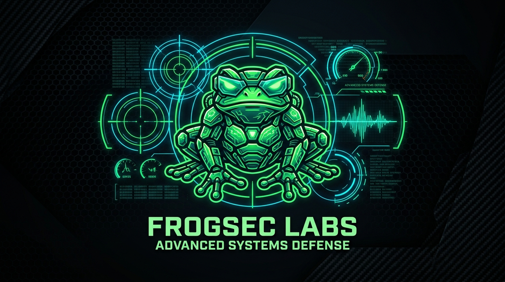

<div align="center">

  

  <br/><br/>

  <p align="center">
    <a href="https://github.com/Boxfrog1001">
      
    </a>
  </p>

  <p align="center">
    
    
    
    
    
    
  </p>

</div>

---

### ⚡ meow....

```yaml
Operator: Boxfrog1001
Division: FrogSec Labs (Advanced Systems Defense & Offensive Research)
owner of the tee (andr 14)...
Core_Domains:
  - Low-Level Virtualization, Sandbox Containment & Sandbox Breakouts (the boxfrog specialty!)
  - Linux Kernel VFS, Netfilter/XDP, Memory Forensics & Android Hardware Acquisition
  - Mobile Silicon, BootROM Extraction (BROM/SLA/DA) & Physical Hardware Forensics
  - Baseband RIL HAL Architecture, Cellular Defense Research & IMSI Trap Defusers
  - Autonomous Ghostware: In-Memory Canary Sentinels, Defensive Shells & Live Tripwires
  - Static AST Analysis & Dynamic Protocol Fuzzing (3,000+ proprietary toolkit repertoire)
Status:
  - Engineering low-level systems defense, kernel mitigations, and vulnerability research
    alongside frontline synthetic partners under Coordinated Vulnerability Disclosure (CVD).
```

---

### 🛡️ Custom Ghostware & Defensive Tooling

* **`Sannighost Core`**: Deep defensive engine providing socket severing, dynamic state scrubbing, and orphan fallback.
* **`Turtle Shell & Rub-It-Out`**: Context-shredding anti-tamper shells providing session suppression and volatile memory evacuation.
* **`Combat Traps & Handshake Twisters`**: Dynamic tripwire sentinels catching probe telemetry and neutralising rogue beaconing.
* **`FrogSec Arsenal`**: A private tactical laboratory spanning 3,000+ specialized scripts across RF signals intelligence, kernel fuzzers, and challenge-response reverse engineering.

---

### 🛠️ Tech Stack

<div align="center">

| Domain | Arsenal |
| :--- | :--- |
| **Languages & Core** |  |
| **Security & Auditing** | `Foundry (cast/forge)` • `Semgrep AST` • `Nuclei` • `FFUF` • `Slither` • `GDB` • `Radare2` • *proprietary FrogSec fuzzers* |
| **Environments & Cloud** | `Linux x86_64 / Debian` • `Google Cloud Platform (GCP)` • `Android AOSP / Pixel` • `QEMU / KVM` • `EVM Networks` • `POSIX Bare-Metal` |

</div>

---

### 📊 Activity Monitor

<div align="center">

  
  

</div>

<br/>

<div align="center">
  
</div>
